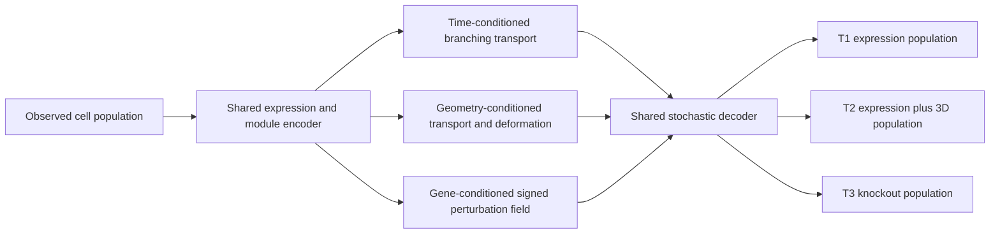

# VEC Modeling Strategy Handbook

An evidence-led model landscape and research proposal for the three tasks in the [Virtual Embryo Challenge](https://virtualembryo.ai/challenge/tasks).

**Status:** research resource, reviewed against the public challenge pages on 26 September 2026. This repository does not claim leaderboard results and does not redistribute challenge data.

## The short answer

The three tasks look similar because they all generate cell populations, but their statistical bottlenecks differ.

| Task | Main bottleneck | Best first serious model | High-upside extension |
|---|---|---|---|
| T1 · temporal | long-range extrapolation with new cell states | hierarchical composition model + low-rank distributional trend | branching, time-conditioned unbalanced transport flow |
| T2 · spatial-temporal | joint expression, shape, scale and local organisation | fused expression/geometry optimal transport for interpolation; separate scale and shape dynamics for extrapolation | stochastic SE(3)-equivariant local deformation model |
| T3 · perturbation | unseen-gene response from one observed knockout | signed, context-specific regulatory propagation with strong shrinkage | graph-conditioned perturbation adapter pretrained on compliant external screens |

Single-cell foundation models are plausible representation modules, not automatic winners. The challenge has few biological conditions, while recent perturbation benchmarks show that simple linear baselines can remain competitive. Every foundation-model experiment should therefore share the same downstream head with PCA and ordinary autoencoder controls.

## Repository map

- [Challenge-to-model map](docs/challenge-to-model-map.md) — what each metric rewards and what it rules out.
- [Model landscape](docs/model-landscape.md) — statistical, deep-learning and foundation/LLM approaches, with applicability and failure modes.
- [Task strategies](docs/task-strategies.md) — recommended T1, T2 and T3 pipelines.
- [EmbryoBridge proposal](docs/embryobridge.md) — one shared architecture with task-specific dynamics.
- [Evaluation plan](docs/evaluation-plan.md) — baselines, pseudo-holdouts, ablations and stopping rules.
- [Paper catalog](references/papers.csv) — 28 machine-readable primary sources.
- [Reading guide](references/reading-guide.md) — the shortest useful route through the literature.
- [Community Award draft](SUBMISSION_TEXT.md) — ready to edit after publication.

## Central proposal: EmbryoBridge

EmbryoBridge represents cells in a shared gene-module latent space, but does not force the three tasks to share the same transition law.



The shared part is the population representation and stochastic decoder. T1 adds developmental time and branching; T2 adds relational geometry, physical scale and local spatial interactions; T3 adds a gene-specific perturbation field. This is enough architectural sharing to test transfer without pretending that time, morphogenesis and knockout response are the same operation.

## Scientific decision layer

The handbook explains which model assumptions match each task, where published evidence transfers, where it does not, and which experiments can falsify the proposed design.

## Validation

The literature catalog and internal references can be checked without installing scientific packages:

```bash
python3 scripts/validate_repository.py
python3 -m unittest discover -s tests -v
```

## Scope and claims

Recommendations are reasoned hypotheses for this competition, not results reported by the cited papers. A paper on temporal interpolation, drug response or cultured cells does not by itself validate mouse-embryo extrapolation. The documents explicitly state these transfer gaps.

External datasets and pretrained checkpoints must be audited against the current [challenge rules](https://virtualembryo.ai/challenge/rules), including indirect exposure to protected stages or genotypes.

## License

Original text, metadata and validation code are released under the [MIT License](LICENSE). Papers, software, data and model weights linked from this repository retain their own licenses.
